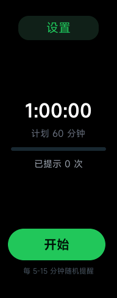
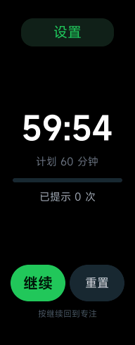
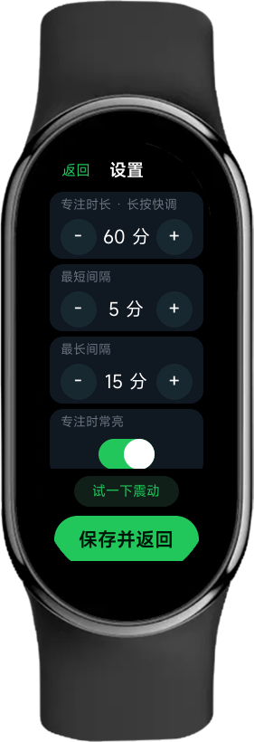
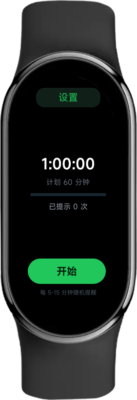

# 专注震动（Focus Buzz）· 小米手环 9 NFC 快应用

> 把手环做成一个「随机震动番茄钟」：设一段专注时间，期间它隔一会儿就随机震动提醒你回神——**全程不用看屏幕**。

灵感来自 B 站视频《为什么我能每天学习 10 小时》里的「随机提示音」番茄钟：把提示音换成震动，就成了手环上最合适的功能。一个手势都不用做，震三下 = 该歇 10 秒，震一下 = 继续干活。

基于小米 **Vela** 快应用框架（`aiot-toolkit` 2.0.3）开发，包名 `com.band.focusbuzz`，成品 **31 KB**，纯 JS / UX，无任何第三方库。



---

## 目录

- [功能](#功能)
- [它是怎么工作的](#它是怎么工作的)
- [截图](#截图)
- [快速开始](#快速开始)
- [装到手环](#装到手环)
- [项目结构](#项目结构)
- [实现细节（踩坑记录）](#实现细节踩坑记录)
- [平台限制](#平台限制)
- [FAQ](#faq)
- [更新记录](#更新记录)
- [许可](#许可)

---

## 功能

| 功能 | 说明 |
| --- | --- |
| 随机间隔提醒 | 每轮在【最短间隔, 最长间隔】里重新抽一个间隔（默认 5–15 分），到点震动 |
| 休息提示 | 提醒后 10 秒内**只把倒计时数字变灰**，计时不暂停；10 秒后变回白色并再震一下 |
| 倒计时 | 大号数字自动适配字号，`00:00` 和 `0:00:00` 左右留白一致，不会换行 |
| 一键控制 | 底部单个主按钮：开始 / 暂停 / 继续；**暂停后**右侧才出现等宽的「重置」 |
| 长按重置 | 运行中长按主按钮可直接重置本轮，不用先暂停 |
| 内嵌设置 | 设置是同页面里的面板，改完立刻生效（不走路由、不重载页面） |
| 专注时常亮 | 开关控制 `setKeepScreenOn`，开=准点震动，关=省电但熄屏不震 |
| 设置持久化 | `@system.storage` 保存，退出应用、重启手环都还在 |
| 试一下震动 | 设置面板里的「试一下震动」胶囊，点一下验证马达 |
| 药丸屏适配 | 上下圆弧区不放内容，所有元素压在 170px 宽以内居中 |

## 它是怎么工作的

```
开始专注 ──随机 5~15 分钟──> 震三下 ──> 倒计时变灰 10 秒（计时不暂停！）──> 震一下，颜色变回白色
   ↑                                                                          │
   └──────────────────────── 重新抽一个随机间隔 ←──────────────────────────────┘
```

- 每个间隔都重新随机，不会连着两次撞在一起
- 变灰的 10 秒里除了数字颜色什么都不变，剩余时间照常走
- 专注时长走完：两下长震 + 显示完成，主按钮变成「再来一轮」
- 全程不用看屏幕：震三下 = 歇 10 秒，震一下 = 继续

### 主界面

- 顶部正中是「设置」胶囊（132×40），屏幕上没有任何状态小字，状态靠颜色和文案表达
- 中间是自适应大小的倒计时，下面是计划时长 + 一条 4px 细进度条
- 进度条正下方居中一行 `已提示 N 次`
- 底部正中绿色主按钮（160×52）：`开始 / 暂停 / 继续`
- **暂停后**：主按钮收窄到半宽，右侧同时出现等宽的深灰「重置」；点继续立刻换回单按钮
- 长按主按钮 = 直接重置本轮

### 设置面板

点顶部「设置」，面板在同一页面里切换上来，**不走路由、不重新加载**，所以每一项改完立刻生效（`applyEditedSettings()` 会同步 `sessionMs`、重排下一次提醒、按开关切换亮屏）。

| 项目 | 范围 | 操作 |
| --- | --- | --- |
| 专注时长 | 10–120 分 | 点 `+` 一次 +5 分，**长按连续加速**，120 分封顶 |
| 最短间隔 | 1–59 分 | 点 `+/-` 一次 1 分，长按加速 |
| 最长间隔 | 最短+1 ~ 120 分 | 同上 |
| 专注时常亮 | 开 / 关 | `switch` 开关，关掉更省电 |
| 试一下震动 | — | 点一下震三下，确认马达正常 |

存储 key：`focus_buzz_settings_v3`。底部「保存并返回」会再存一次并回到主界面。

## 截图

| 未开始 | 暂停（出现重置） | 设置 |
| --- | --- | --- |
|  |  |  |

下面是把帧缓冲合成到 `xiaomi_band` 皮肤机身上的效果（用皮肤自带的 `foreground.png` 做药丸遮罩，能直接看出内容有没有被弧边切到）：



## 快速开始

### 环境

- Node.js ≥ 10（实测 v24.14.0 可用）
- Windows PowerShell 5.1 或 PowerShell 7
- 首次 `npm install` 需要联网（默认走 npmmirror 镜像，见 `.npmrc`）

```powershell
git clone https://github.com/1TRhez/-.git focus-buzz
cd focus-buzz
npm install
```

### 打包

```powershell
powershell -File .\build.ps1
# -> dist\com.band.focusbuzz.debug.1.2.5.rpk
```

> **为什么不直接 `npm run build`？**
> 如果你的项目路径里带 `#`（例如 `#文档收纳文件夹`），`aiot-toolkit` 内部的 webpack 会把 `#` 当成 loader 字符串分隔符，报
> `Unable to resolve loader ...ruleSet[1].rules[0].use[0]#文档收纳文件夹\...`
> `build.ps1` 用 `subst` 把项目临时映射成 `X:\` 这种干净盘符，打完再解除；同时它还会检查 `aiot build` 的输出（该命令报错时**退出码仍然是 0**）和 `dist` 里 rpk 的时间戳，避免拿到旧包。

### 预览包（给模拟器用）

```powershell
powershell -File .\preview.ps1
# -> preview-rpk\com.band.focusbuzz.preview.rpk（designWidth=466）
```

## 装到手环

第三方快应用没有官方安装入口，目前是**非官方路线**，都有风险，自行判断：

### 路线 A：表盘自定义工具（免 root，推荐）

1. 手环和手机正常配对，手机装「表盘自定义工具」
2. 用它的「安装快应用 / 第三方应用」入口把 `dist\*.debug.*.rpk` 推到手环
3. 装完在手环应用列表里能看到「专注震动」

### 路线 B：Xposed 模块（需要 root 或 LSPatch）

1. 手机装国际版小米运动健康 **3.30.1i**
2. 装 LSPosed 模块 **Wearable Debug**（无 root 可用 LSPatch 重打包）
3. 在「关于 → 用户协议」里输入包名安装 rpk

### 注意事项

- **装之前先卸载旧包**，否则启动器可能沿用旧的图标/代码缓存
- 手环固件更新可能随时堵住这些口子；非官方应用有卡 logo 的风险
- 仓库里的 `release/` 目录放了已经打好的 rpk，可以直接下载

## 项目结构

```
.
├─ src/
│  ├─ manifest.json          应用配置（包名、designWidth=192、单页面路由、用到的 system 能力）
│  ├─ app.ux                 应用入口
│  ├─ config-watch.json      设备类型配置
│  ├─ common/
│  │  ├─ logo.png            应用图标（96×96 原生尺寸，见下文）
│  │  ├─ vibrate.js          震动封装：buzzTwice / buzzOnce / buzzDone
│  │  └─ settings.js         storage 读写 + 默认值 + 范围夹紧
│  └─ pages/index/index.ux   唯一页面：主界面 + 内嵌设置面板 + 提醒状态机
├─ build.ps1                 打手环正包（designWidth=192）
├─ preview.ps1               打模拟器预览包（designWidth=466）
├─ release/                  已经打好的 rpk
├─ docs/screenshots/         README 用图
└─ tools/
   ├─ emulator-setup.js      下载模拟器镜像并创建虚拟设备
   ├─ run-emulator.js        启动模拟器 → 装包 → 运行
   ├─ install.ps1            把 dist 里最新的 rpk 装进运行中的模拟器
   ├─ set-manifest.js        临时改 designWidth / 路由入口
   ├─ shot.ps1               抓模拟器帧缓冲并归一到 192×490
   ├─ clean-shot.py          等比缩放或 1:1 居中裁
   ├─ device-shot.py         合成到 xiaomi_band 皮肤机身图上
   ├─ make_icon.py           生成应用图标
   ├─ verify_rpk.py          校验 rpk 里的版本 / designWidth / 图标尺寸
   └─ dev/                   调试开关脚本（AUTO_START / DEMO_FAST）
```

## 实现细节（踩坑记录）

### 1. 震动只有两档，没有强度

手环 9 / 9 Pro 的 `@system.vibrator` 只支持 `vibrate({ mode: 'long' | 'short' })`，没有振幅/时长参数（`vibrator.start/stop` 是 Watch S5 才有的）。所以：

- 提醒 = **连震三下长震**（间隔 260ms）——靠次数和时长堆出存在感
- 回专注 = 一下短震
- 一轮结束 = 两下长震（间隔 420ms）

想要更强/更弱，改 `src/common/vibrate.js` 里的 `PULSE_GAP` 和脉冲次数即可。

### 2. 熄屏会被挂起

快应用只有 `system.audio` / `system.request` / `system.geolocation` 三类能申请后台驻留，番茄钟不在其中。所以：

- 「专注时常亮 = 开」：`brightness.setKeepScreenOn(true)` 让屏幕常亮，计时器就不会被挂起 —— 这是**准点震动的唯一可靠方式**，代价是费电
- 「专注时常亮 = 关」：省电，但熄屏期间不震；抬手亮屏时 `onShow` 会调用 `catchUp()`，发现错过了就补一次
- 不管哪种，剩余时间都按 `Date.now()` 差值重算，不会因为挂起错乱

### 3. 倒计时字号自适应

`fitClockFont(text)`：`字号 = 170 / (字符数 × 0.52)`，夹在 24–64 px，再乘屏幕缩放系数。`00:00` 和 `0:00:00` 左右留白一致，不会换行也不会缩成一坨。

> 曾有个 bug：`data` 里没给 `clockSize2` 初值，首帧绑定到 `undefined`，Vela 按默认小字号渲染（表现为「刚进应用字特别小，随便改个设置又恢复」）。现在 `data` 里给了初值，`onInit` 里也补一次 `updateView()`。

### 4. 暂停后按钮「换装」不做动画

早期版本用 6 帧 `setTimeout` 逐帧改按钮宽度做动画，结果：动画期间 `width: 0` 会让「重置」两个字按字符折行，动画结束后不会重排 —— 显示成竖排的「重\n置」。现在改成一次性赋值宽度（160 ⇄ 78），瞬间切换，既流畅又不会错排。

### 5. 图标：原生 96×96，不要让系统去缩放

固件镜像里同时有这两条配置：

- `CONFIG_LAUNCHER_ICON_SIZE 144`
- `CONFIG_LVX_LIST_ITEM_HEIGHT 120`

列表行高只有 120，而启动器**按原生像素绘制、不做缩放**，所以 144 甚至 192 的图必被裁掉底边（这是「图标底部被切／有残影」的根因）。把 PNG 直接存成 **96×96**（`bbox 0,0,96,96`），落在行内，四周都有余量。

### 6. 模拟器是方屏，手环是药丸屏

vela 4.0 模拟器镜像把快应用画布**固定成 466×466**（手表尺寸），与虚拟设备里填的宽高无关。所以：

- 预览包用 `designWidth=466`：1 设计像素 = 1 物理像素，我们 192 宽的设计居中显示，抓图后**居中裁 192 宽**就是手环上的真实观感
- 手环正包用 `designWidth=192`：装在 192×490 屏上 1:1
- 页面上下各留固定高度的安全区（不用 padding 简写，Vela 不认 `padding: 8px 12px` 这种二值写法），所有内容压在 170px 宽内

### 7. Vela 的几条脾气

| 脾气 | 表现 | 对策 |
| --- | --- | --- |
| 没有 `am force-stop` | 换包后旧 quickapp 实例还在跑，看到的是旧界面 | 杀模拟器进程重新 `run-emulator.js` |
| `pm install` 覆盖不生效 | 包已存在时「安装成功」但代码不替换 | `install.ps1` 先 `pm uninstall` 再装 |
| 不认 `padding` 简写 | 二值 padding 被忽略，文字贴边 | 用子元素 `margin-left` |
| 没有触摸注入 | `adb shell input` 不存在 | 主界面留 `AUTO_START` / `DEMO_FAST` 两个调试开关 |

## 平台限制

| 限制 | 说明 | 本项目处理 |
| --- | --- | --- |
| 震动只有两档 | 只支持 `mode: 'long'` / `'short'` | 多次脉冲拼节奏 |
| 不能后台跑 | 只有三类 feature 可后台驻留 | keepScreenOn + `onShow` 补算 |
| 包体要小 | 手环内存紧张 | 纯 JS/UX，无第三方库，31 KB |
| 不支持 NFC | 第三方拿不到 NFC 权限 | 本项目不需要，NFC 版与标准版对开发无差别 |
| 192×490 药丸屏 | 上下各约 60px 圆弧 | 定高安全区 + 170px 内容宽 |
| 触摸事件有限 | touchstart/move/end、click、longpress、swipe | 长按重置、长按加速都基于 `ontouchstart/end` + 定时器 |
| 模拟器方屏 | 画布固定 466×466 | 预览包 `designWidth=466`，正包 192 |

## FAQ

**Q：装了没反应 / 还是旧界面？**
先卸载旧包再装；然后彻底退出应用（不是回桌面）重新打开。

**Q：为什么必须开「专注时常亮」才准点震？**
见[实现细节第 2 条](#2-熄屏会被挂起)：熄屏后系统会挂起计时器，这是平台限制，不是应用的 bug。

**Q：标准版小米手环 9 能用吗？**
可以，本项目不依赖 NFC，NFC 版与标准版对快应用开发没有区别。

**Q：图标还是被裁？**
确认 `src/common/logo.png` 是 96×96 且四周没有贴边，并卸载重装清缓存。

**Q：能改震动强度吗？**
改不了振幅，只能改次数和 `mode`（long/short）。见[实现细节第 1 条](#1-震动只有两档没有强度)。

## 更新记录

### v1.2.5

- 修复首次进入应用倒计时字号极小（`clockSize2` 缺初值）
- 应用图标改为**原生 96×96**，解决启动器裁切
- 版本号 `1.2.5` / `versionCode 8`

### v1.2.x

- 图标尺寸反复试错：192 → 100 → 144 满幅 → 144 画布 + 112 内容 → 144 画布 + 96 内容，最终确认走原生尺寸
- 从固件镜像里确认 `CONFIG_LAUNCHER_ICON_SIZE 144` 与 `CONFIG_LVX_LIST_ITEM_HEIGHT 120` 是裁切根因

### v1.2.0

- 去掉暂停/重置的宽度动画（修「重置」竖排）
- 设置胶囊放大到 132×40 并下移
- 提醒改为连震三下长震
- 倒计时字号按字符数自适应
- 设置面板改为同页内嵌，改完立即生效

### v1.1

- 重绘应用图标（淡蓝圆形 + 白色振动闹钟）
- 设置页底部加版本水印，四张卡片高度收紧，消除截断

### v1.0

- 首个可用版本：随机震动提醒、10 秒变灰休息、设置持久化、药丸屏布局

## 许可

[MIT](LICENSE) © 2026 1TRhez
